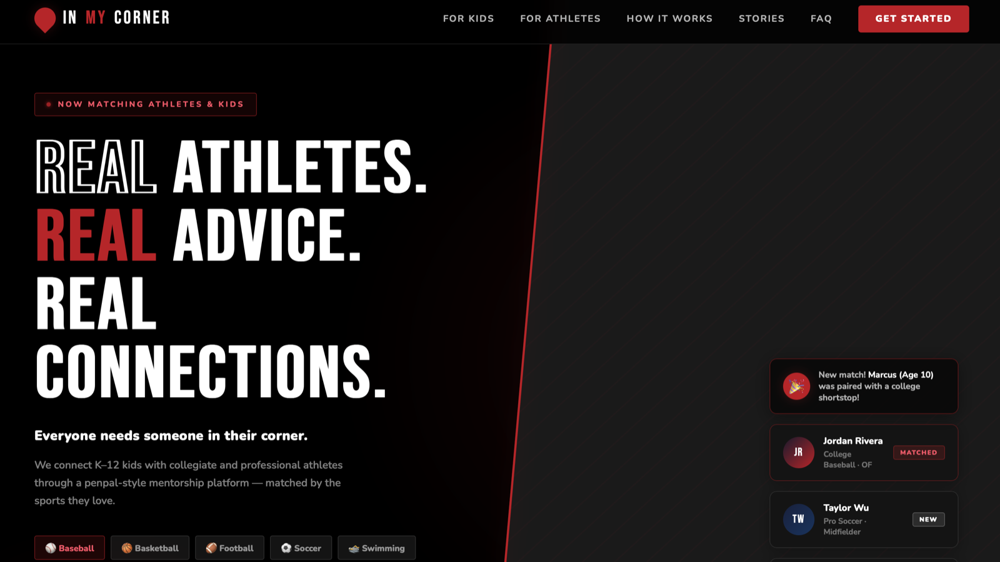
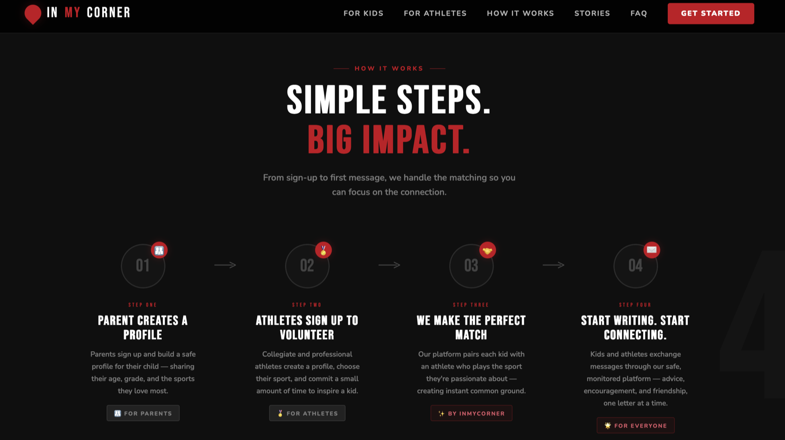
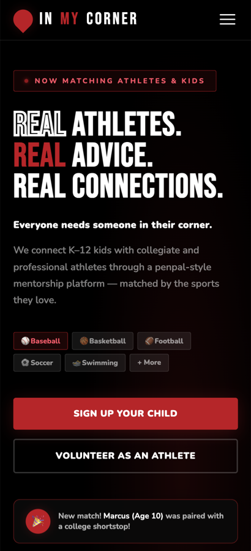

# InMyCorner

**Real athletes. Real advice. Real connections.**

A mentorship platform concept that connects K–12 kids with collegiate and
professional athletes through a penpal-style experience. It's a responsive
front-end site with sign-up flows for families and athlete mentors, backed by
Supabase.

**Live demo:** https://cmarsee-blip.github.io/inmycorner/

> Sign-ups are turned off on the live demo. Please don't enter real
> information. To try the sign-up flow, run the site locally against your own
> Supabase project (see below).

## Screenshots

**Home**



**How it works**



**Mobile**



## What it does

- **Responsive single-page site**: fixed navigation with a hamburger menu on
  mobile, a full-screen hero with floating athlete cards and stats, a 4-step
  "How It Works" with scroll-triggered animations, a testimonials grid, a
  filterable FAQ accordion (Parents / Athletes / Safety), and a footer.
- **Two sign-up flows**: families (parent and young athlete details) and
  athlete mentors, using Supabase Auth. A database trigger creates the matching
  profile row, and new users confirm their email address.
- **Custom breakpoints** for desktop, tablet and mobile.

All athletes, testimonials and stats on the page are sample content.

## Tech stack

- HTML5, CSS3 and vanilla JavaScript, with no framework or build step
- Supabase (Auth and Postgres) through `supabase-js`, loaded from a CDN
- Google Fonts: Bebas Neue for headings, Nunito for body text

## Run it locally

```bash
git clone https://github.com/cmarsee-blip/inmycorner.git
cd inmycorner
```

Open `index.html` in a browser, or serve the folder with the VS Code Live
Server extension.

`js/supabase-config.js` points at my Supabase project. To test sign-ups, create
your own project, run `supabase-schema.sql` in its SQL editor, and replace the
project URL and publishable key in that file. Otherwise accounts you create
locally would land in my project.

## Project structure

```
inmycorner/
├── index.html              all page sections and the sign-up modals
├── css/
│   └── styles.css          styles and responsive breakpoints
├── js/
│   ├── main.js             navigation, FAQ and animations
│   ├── auth.js             family and mentor sign-up flows
│   └── supabase-config.js  Supabase client setup
├── supabase-schema.sql     tables, policies and profile triggers
└── screenshots/
```

## Brand colors

| Color | HEX       |
| ----- | --------- |
| Red   | `#C6011F` |
| Black | `#000000` |
| White | `#FFFFFF` |

## Responsive breakpoints

| Breakpoint   | Width    |
| ------------ | -------- |
| Desktop      | > 1024px |
| Tablet       | ≤ 1024px |
| Mobile       | ≤ 768px  |
| Small mobile | ≤ 480px  |
